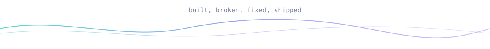

<a href="https://rico.bd/">
  <picture>
    <source media="(prefers-color-scheme: dark)" srcset="assets/hero-dark.svg">
    
  </picture>
</a>

 

I like the place where software meets the physical world. Most days that means full-stack apps that real people depend on; on the other days it is a microcontroller on the desk, a server humming in the corner, or a logo that will not sit right yet. I study Computer Science and Engineering at IUBAT and keep my work at **[rico.bd](https://rico.bd/)**.

### Now building

  <a href="https://singercms.bohuvuj.com/"><picture><source media="(prefers-color-scheme: dark)" srcset="assets/card-collectra-dark.svg"></picture></a>
  <a href="https://rico.bd/"><picture><source media="(prefers-color-scheme: dark)" srcset="assets/card-timeforge-dark.svg"></picture></a>
  <a href="https://rico.bd/"><picture><source media="(prefers-color-scheme: dark)" srcset="assets/card-systracker-dark.svg"></picture></a>
  <a href="https://github.com/Redwan002117/RuView"><picture><source media="(prefers-color-scheme: dark)" srcset="assets/card-homelab-dark.svg"></picture></a>

Also on the bench: an **ESP32 line-follower** you drive over its own Wi-Fi page, **Purrfect Feeder** for a cat with opinions, **Subash**, a fragrance storefront, and IT work for **SK IT Centre**.

### Toolbox

  <picture>
    <source media="(prefers-color-scheme: dark)" srcset="https://skillicons.dev/icons?i=ts,js,py,c,cpp,go,java,php,powershell,react,nextjs,svelte,vue,tailwind,flutter,threejs,nodejs,postgres,supabase,prisma,redis,mysql,sqlite,firebase,docker,linux,nginx,cloudflare,vercel,netlify,gcp,githubactions,git,raspberrypi,arduino,figma,ai,ae&perline=13&theme=dark">
    
  </picture>

### In numbers

  <picture>
    <source media="(prefers-color-scheme: dark)" srcset="https://ghstats.dev/api/card?username=Redwan002117&theme=dark&hide_border=true&border_radius=16&size=compact">
    
  </picture>
  <picture>
    <source media="(prefers-color-scheme: dark)" srcset="https://ghstats.dev/api/langs?username=Redwan002117&theme=dark&hide_border=true&border_radius=16&layout=compact">
    
  </picture>

  <picture>
    <source media="(prefers-color-scheme: dark)" srcset="https://ghstats.dev/api/sparkline?username=Redwan002117&theme=dark&hide_border=true&days=90&width=880&height=140">
    
  </picture>

### Find me

  &nbsp;&nbsp;
  &nbsp;&nbsp;
  &nbsp;&nbsp;
  &nbsp;&nbsp;
  &nbsp;&nbsp;
  &nbsp;&nbsp;
  &nbsp;&nbsp;
  &nbsp;&nbsp;
  &nbsp;&nbsp;
  &nbsp;&nbsp;
  &nbsp;&nbsp;
  

<picture>
  <source media="(prefers-color-scheme: dark)" srcset="assets/footer-dark.svg">
  
</picture>

<!-- Artwork: tools/build_assets.py draws assets/*.svg (light and dark). -->
